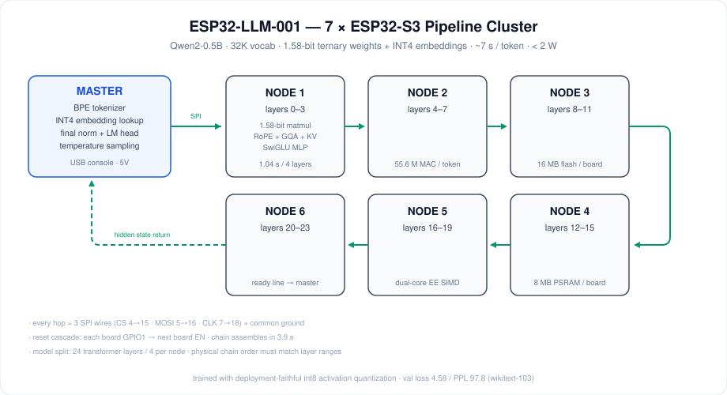
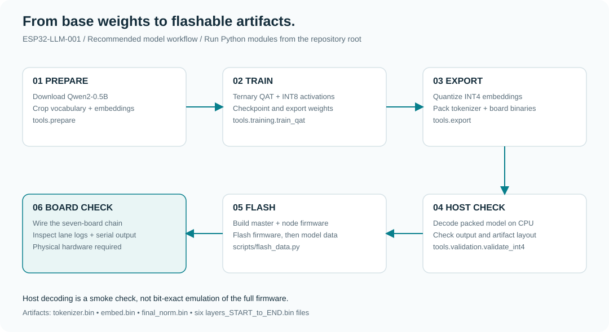

# ESP32-LLM-001

**An experimental Qwen2-0.5B inference pipeline across seven ESP32-S3 boards.**

[简体中文](README.zh-CN.md) · [Getting started](docs/getting-started.md) · [Architecture](docs/architecture.md) · [Releases](https://github.com/Crucifixion-Fxl/ESP32-LLM-001/releases) · [Contributing](CONTRIBUTING.md)


[](LICENSE)




## Overview

This project explores local language-model inference on low-cost microcontrollers.
One master board performs tokenization, embedding lookup, final normalization and
sampling. Six compute nodes each execute four transformer layers and pass hidden
states over SPI; the last node returns the result to the master.

The model uses ternary weights (`−1, 0, +1`) stored in two-bit codes, INT4
embeddings, and per-vector INT8 activation quantization in the compute kernels.
The firmware includes an Xtensa MAC-kernel correction and a 64-case boot-time
lane diagnostic. The primary QAT trainer simulates the activation quantization
used by the firmware.

**This is a research prototype, not a general-purpose conversational assistant.**
Generated text may repeat or be incoherent. Host-side validation checks packed
weight decoding; it does not establish bit-exact agreement with the entire board
pipeline. See [limitations and validation scope](docs/architecture.md#validation-and-limitations).

## Start here

| Goal | Entry point |
| --- | --- |
| Run the existing model on seven boards | [Release flashing and wiring guide](docs/getting-started.md) |
| Follow the detailed Chinese walkthrough | [中文复现指南](docs/getting-started.zh-CN.md) |
| Prepare, train and export a model | [Model toolchain](tools/README.md) |
| Build firmware from source | [Master firmware](firmware/master/README.md) · [Node firmware](firmware/node/README.md) |
| Understand the design and flash layout | [Architecture](docs/architecture.md) |
| Find a renamed script | [Path migration guide](docs/repository-layout.md) |

### Host setup

Run these commands from the repository root. The locked host environment uses
Python 3.14; ESP-IDF has a separate Python environment.

```bash
git clone https://github.com/Crucifixion-Fxl/ESP32-LLM-001.git
cd ESP32-LLM-001
uv sync --locked
uv run python -m tools.training.train_qat --help
uv run python scripts/flash_data.py --help
```

Model downloads, checkpoints and binaries stay outside Git. Existing
`Qwen2-0.5B/` and `cropped_Qwen/` directories remain supported. Set
`ESP32_LLM_WORKSPACE` to place these artifacts elsewhere.

### Firmware build

With ESP-IDF v6.1-beta1 installed and its environment activated:

```bash
idf.py -C firmware/master set-target esp32s3
idf.py -C firmware/master build
idf.py -C firmware/node set-target esp32s3
idf.py -C firmware/node build
```

Build outputs remain `master_board.bin` and `node_board.bin`, matching the v1.0.0
release filenames. Flashing firmware and flashing model data are separate steps;
follow the [complete guide](docs/getting-started.md) before connecting the cluster.

## Model deployment



The recommended commands live in `tools/prepare`, `tools/training`,
`tools/export` and `tools/validation`. Earlier training variants are retained
under `tools/experiments` and are not the recommended deployment path.

## Reported results

These are **historical v1.0.0 experiment notes**, not benchmarks rerun on each
commit. Conditions and debugging observations are recorded in the
[development notes (Chinese)](docs/development-notes.zh-CN.md).

| Item | Reported configuration / result |
| --- | --- |
| Hardware | 7 × ESP32-S3 N16R8; 16 MB flash and 8 MB PSRAM per board |
| Model | Qwen2-0.5B; 24 layers; vocabulary cropped to 32,000 |
| Training | WikiText-103; 4,000 steps; validation loss 4.58 / perplexity 97.8 |
| Generation | Approximately 7 seconds per token end to end |
| Power | Approximately 1.2 W idle / 1.5 W generating |
| Context | Node KV-cache limit: 512 tokens; tokenizer input buffer: 256 tokens |

Serial return-link corruption and long first-token stalls were observed in the
original setup. Do not treat training quality, host output or a successful build
as proof of a working physical cluster.

## Repository layout

```text
firmware/             ESP-IDF projects for the master and compute nodes
tools/                Python modules for preparation, training, export and analysis
scripts/              Flashing, container training and repository maintenance
tests/                Host regression checks; no attached hardware required
docs/                 Setup, architecture, migration guide and experiment notes
  diagrams/           Editable diagram source documentation
  images/             Generated SVG diagrams used by the guides
.github/              CI and issue / pull-request templates
```

## Development

```bash
uv sync --locked --extra analysis
uv run python -m unittest discover -s tests -v
uv run python scripts/check_repository.py
uv run python scripts/render_diagrams.py --check
```

These checks cover host tooling and repository integrity. Firmware builds and
physical-board checks have distinct scopes; report both when contributing.

## Attribution and license

This repository builds on
[Low-Zi-Hong/ESP32s3-LLM-Cluster](https://github.com/Low-Zi-Hong/ESP32s3-LLM-Cluster),
which provided the seven-board architecture, firmware foundation and initial
model tooling. Additional work here includes the MAC-kernel correction and
activation-aware QAT workflow. The ternary-weight approach is informed by
[Microsoft BitNet](https://github.com/microsoft/BitNet); the base model is
[Qwen2-0.5B](https://huggingface.co/Qwen/Qwen2-0.5B).

Repository code is [MIT licensed](LICENSE); the upstream copyright notice is
preserved. Model weights and datasets retain their respective upstream terms.
