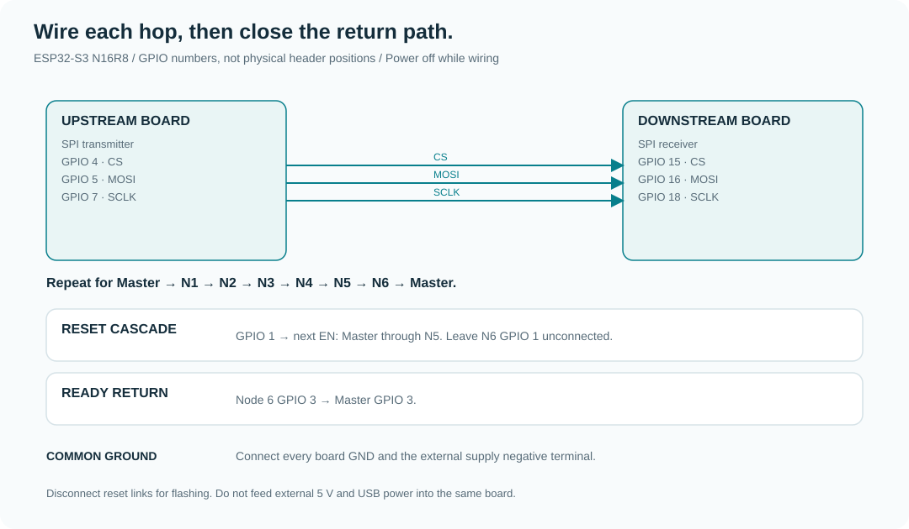

# Getting started

[Overview](../README.md) · [中文指南](getting-started.zh-CN.md) · [Wiring reference](architecture.md#wiring)

## Requirements

- Seven **ESP32-S3 N16R8** boards, each with 16 MB flash and 8 MB octal PSRAM.
- USB data cable, short jumper wires, common ground and suitable 5 V power.
- For release flashing: Python and `esptool` (`python -m pip install esptool`).
- For source tooling: [uv](https://docs.astral.sh/uv/) and the locked Python 3.14 environment.
- For firmware builds: ESP-IDF **v6.1-beta1**, with ESP32-S3 tools installed.
  See the [official setup guide](https://docs.espressif.com/projects/esp-idf/en/latest/esp32s3/get-started/).

Label the boards Master and Node 1–6 before flashing. Node position determines
which layer file it needs. Flash boards individually with reset links disconnected.

## Option A: use release artifacts

Download `firmware-master.zip`, `firmware-node.zip` and `model-bins.zip` from
[v1.0.0](https://github.com/Crucifixion-Fxl/ESP32-LLM-001/releases/tag/v1.0.0).
Extract each archive separately to avoid mixing master and node partition tables.
The commands below assume the named files are in the current working directory;
change into the appropriate extracted folder or use explicit file paths.
Replace `PORT` with your device, such as `/dev/cu.usbmodemXXXX`, `/dev/ttyACM0`
or `COM3`. Never copy an example port without checking your connected board.

### Master

From the master firmware directory:

```bash
python -m esptool --chip esp32s3 --port PORT --baud 921600 write-flash \
  0x0 bootloader.bin 0x8000 partition-table.bin 0x10000 master_board.bin
```

From the model archive directory containing these files:

```bash
python -m esptool --chip esp32s3 --port PORT --baud 2000000 write-flash \
  0x90000 tokenizer.bin 0x150000 embed.bin 0xFF0000 final_norm.bin
```

### Nodes 1–6

Flash the same node firmware to each node, then its own four-layer model file:

```bash
python -m esptool --chip esp32s3 --port PORT --baud 921600 write-flash \
  0x0 bootloader.bin 0x8000 partition-table.bin 0x10000 node_board.bin
python -m esptool --chip esp32s3 --port PORT --baud 2000000 write-flash \
  0x90000 layers_0_to_3.bin
```

| Physical position | Layer file |
| --- | --- |
| Node 1 | `layers_0_to_3.bin` |
| Node 2 | `layers_4_to_7.bin` |
| Node 3 | `layers_8_to_11.bin` |
| Node 4 | `layers_12_to_15.bin` |
| Node 5 | `layers_16_to_19.bin` |
| Node 6 | `layers_20_to_23.bin` |

## Option B: build and prepare from source

All host commands below run from the repository root:

```bash
uv sync --locked
uv run python -m tools.prepare.prepare_colab
uv run python -m tools.training.train_qat --steps 4000
uv run python -m tools.export.quantize_embeddings
uv run python -m tools.export.pack_tokenizer
uv run python -m tools.export.pack_weights
uv run python -m tools.validation.validate_int4
```

The preparation step downloads the base model if absent. Training can require
substantial GPU time and downloads WikiText-103. See [toolchain details](../tools/README.md)
for checkpoint resume, individual preparation stages and alternate workspaces.
The CPU validation command checks packed-weight decoding and generation only;
it is not full firmware emulation.

After activating your ESP-IDF environment, still from the repository root:

```bash
idf.py -C firmware/master set-target esp32s3
idf.py -C firmware/master build
idf.py -C firmware/node set-target esp32s3
idf.py -C firmware/node build
idf.py -C firmware/master -p PORT flash
# Change the connected board, then flash each node:
idf.py -C firmware/node -p PORT flash
```

Model data is a separate flash operation. Review the command first:

```bash
uv run python scripts/flash_data.py master --port PORT --dry-run
uv run python scripts/flash_data.py node --port PORT --layer layers_0_to_3.bin --dry-run
```

Remove `--dry-run` to flash. Use the matching file for each node. The script
expects `tokenizer.bin` in `cropped_Qwen/` and model binaries in
`cropped_Qwen/bins/`; `--model-dir` selects a different artifact directory.
The raw release commands above do not require that directory convention.

## Connect and boot



1. Power off and wire all seven SPI hops, including Node 6 → Master.
2. Connect the reset cascade, ready return and common ground exactly as in the
   [wiring reference](architecture.md#wiring).
3. Power the nodes and connect the master USB serial console at 115200 baud.
4. Inspect the startup logs, then enter a short prompt. Each generated token
   requires the complete six-node pass.

The node diagnostic prints `UNIT begin`, 64 ASM/C++ comparisons and `UNIT end`.
The master reports `ALL NODE READY!!!` when ready. These messages alone do not
prove correct inference: compare diagnostic values and inspect end-to-end output.

## Troubleshooting

| Symptom | Check |
| --- | --- |
| Cannot connect for flashing | Correct serial port; data-capable USB cable; reset links disconnected; BOOT/RST download sequence |
| PSRAM or partition errors | N16R8 hardware, correct SDK defaults, correct role's partition table |
| Master never reaches ready | Reset cascade and Node 6 GPIO 3 → Master GPIO 3 |
| SPI magic mismatch or long first-token stall | Node 6 → Master return hop, short wires, stable supply and common ground |
| Incoherent or repetitive output | Correct layer placement; host smoke output; known model-quality limits |
| Script cannot find model files | Run modules from the root; inspect `ESP32_LLM_WORKSPACE` and the toolchain order |

See [historical development notes](development-notes.zh-CN.md) for the original
investigation. This guide does not imply the hardware was retested for a docs change.
